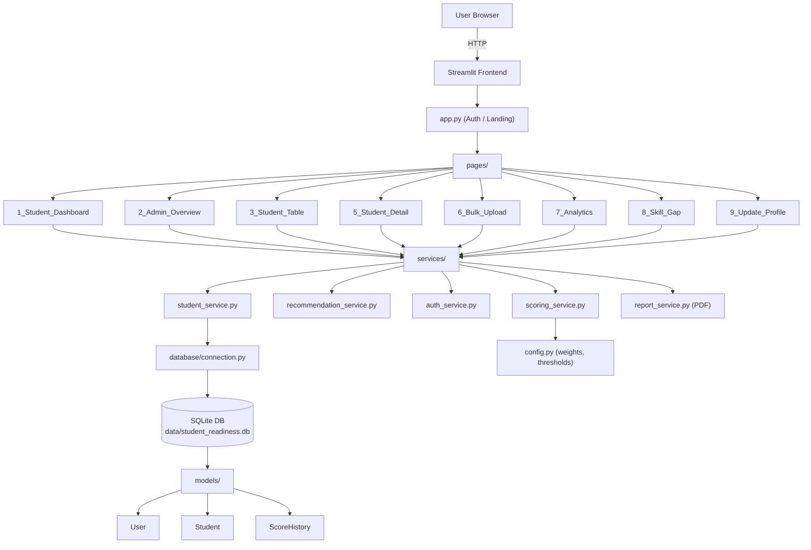

# 🎓 TalentForge — Student Placement Readiness Dashboard

> **A production-quality web system to measure, track and visualize how ready students are for placements and careers.**

Built with **Streamlit**, **Plotly**, **SQLAlchemy/SQLite**, and **ReportLab** — deployable in one click to Streamlit Community Cloud.

---

## 📋 Table of Contents

- [Features](#features)
- [Architecture](#architecture)
- [Tech Stack](#tech-stack)
- [Readiness Model](#readiness-model)
- [Project Structure](#project-structure)
- [Quick Start](#quick-start)
- [Demo Credentials](#demo-credentials)
- [Screenshots](#screenshots)
- [Running Tests](#running-tests)
- [GitHub & Deployment](#github--deployment)
- [Configuration](#configuration)
- [Design Decisions](#design-decisions)

---

## ✨ Features

### 🧑‍🎓 Student Portal
| Feature | Description |
|---------|-------------|
| **Readiness Gauge** | Animated Plotly gauge showing overall score vs. Ready threshold |
| **Competency Radar** | 7-axis radar chart with student score and target overlay |
| **Progress Trend** | Line chart of monthly score history |
| **Cohort Rank & Percentile** | Live ranking against all peers |
| **Skill-Gap Analysis** | Per-component deficit vs. benchmark, sorted by impact |
| **Personalised Roadmap** | Rule-based 75-day action plan with resources & timelines |
| **Update Profile** | Live-preview score calculator before saving |
| **PDF Report** | Download a formatted ReportLab PDF assessment |

### 🏫 Faculty / Admin Portal
| Feature | Description |
|---------|-------------|
| **KPI Cards** | Total students, avg. score, % Ready / Almost Ready / Needs Improvement |
| **Distribution Charts** | Pie, histogram, box plots per level |
| **Department Comparison** | Horizontal bar chart and heatmap |
| **Student Database** | Searchable table with department/year/level filters + CSV/Excel export |
| **Student Detail Drill-down** | Full radar, trend, edit form, recommendations |
| **At-Risk Detection** | Auto-flagged students below 55 with gap-to-ready indicator |
| **Add / Edit / Delete** | Full CRUD from the UI |
| **Bulk CSV Upload** | Upload with row-level validation, downloadable template |
| **Analytics Page** | Year × level grouped bars, violin plots, CGPA scatter, pivot heatmap |

### ⚙️ General
- **bcrypt-hashed** passwords, session-based auth, role-based access
- **Auto-seeds** 160 realistic students with 4-8 months of score history on first run
- **Responsive** professional UI with consistent brand palette and card/KPI components
- **54 unit tests** covering scoring, gap analysis and recommendation engine

---

## 🏗️ Architecture



---

## 🛠️ Tech Stack

| Layer | Technology |
|-------|-----------|
| Frontend | Streamlit 1.40.1, Plotly 5.24.1 |
| Backend | Python 3.11+, pandas 2.2.3 |
| ORM | SQLAlchemy 2.0.36 |
| Database | SQLite (auto-created) |
| Auth | bcrypt 4.2.1 |
| PDF Reports | ReportLab 4.2.5 |
| Excel Export | openpyxl + xlsxwriter |
| Testing | pytest 8.3.3 |

---

## 📐 Readiness Model

Each student receives a **weighted composite score (0–100)**:

| Component | Weight | Description |
|-----------|--------|-------------|
| Technical Skills | 25% | DSA, programming, system design |
| Aptitude & Logic | 20% | Quantitative & logical reasoning |
| Communication | 15% | Verbal, written, presentation |
| Project Quality | 15% | Complexity, deployment, impact |
| Academics (CGPA) | 10% | CGPA scaled to 100-point scale |
| Certifications | 5% | Industry credentials & badges |
| Mock Interviews | 10% | Simulated interview performance |

**Classification:**
- 🟢 **Ready** — Score ≥ 75
- 🟡 **Almost Ready** — Score 55–74
- 🔴 **Needs Improvement** — Score < 55

> Weights are configurable in `config.py` without touching any service code.

---

## 📂 Project Structure

```
STUDENT READINESS/
├── app.py                      # Login / landing page, DB auto-bootstrap
├── config.py                   # Weights, thresholds, departments, metadata
├── seed_data.py                # 160 realistic students + demo accounts
├── requirements.txt
├── .gitignore
├── .streamlit/
│   └── config.toml             # Theme, server settings
├── pages/
│   ├── page_utils.py           # Auth guard, sidebar, shared helpers
│   ├── 1_Student_Dashboard.py
│   ├── 2_Admin_Overview.py
│   ├── 3_Student_Table.py
│   ├── 5_Student_Detail.py
│   ├── 6_Bulk_Upload.py
│   ├── 7_Analytics.py
│   ├── 8_Skill_Gap.py
│   └── 9_Update_Profile.py
├── services/
│   ├── __init__.py
│   ├── scoring_service.py      # Weighted readiness formula
│   ├── recommendation_service.py  # Skill-gap + rule-based recommendations
│   ├── auth_service.py         # bcrypt auth, user management
│   ├── student_service.py      # CRUD + history snapshots
│   └── report_service.py       # PDF generation (ReportLab)
├── models/
│   ├── __init__.py
│   ├── user.py                 # User ORM model
│   ├── student.py              # Student ORM model
│   └── score_history.py        # Score snapshot history
├── database/
│   ├── __init__.py
│   ├── base.py                 # SQLAlchemy declarative base
│   └── connection.py           # Engine, session factory, init_db()
├── utils/
│   ├── __init__.py
│   ├── validators.py           # Input validation + logging
│   └── csv_utils.py            # CSV/Excel import-export
├── assets/
│   └── style.css               # Professional custom CSS
├── data/                       # Auto-created; holds SQLite DB
├── logs/                       # Auto-created; holds app.log
└── tests/
    ├── __init__.py
    ├── test_scoring.py         # 31 tests for scoring service
    └── test_recommendations.py # 23 tests for recommendation engine
```

---

## 🚀 Quick Start

### Prerequisites
- Python 3.11+ installed
- Git installed

### Setup

```bash
# 1. Clone the repo
git clone https://github.com/YOUR_USERNAME/student-readiness-dashboard.git
cd student-readiness-dashboard

# 2. Create and activate a virtual environment
python -m venv venv
# Windows:
venv\Scripts\activate
# macOS/Linux:
source venv/bin/activate

# 3. Install dependencies
pip install -r requirements.txt

# 4. Run the app (auto-seeds DB on first launch)
streamlit run app.py
```

The app will open at **http://localhost:8501**

> **First-run note:** The database is auto-created at `data/student_readiness.db` and seeded with 160 students + demo accounts automatically.

---

## 🔑 Demo Credentials

| Role | Username | Password |
|------|----------|----------|
| Admin / Faculty | `admin` | `admin123` |
| Student | `student1` | `student123` |

---

## 📸 Screenshots

> _Screenshots can be added here after first launch._

| Login Page | Student Dashboard |
|-----------|-------------------|
| _(landing page)_ | _(gauge + radar)_ |

| Admin Overview | Skill Gap Analysis |
|----------------|-------------------|
| _(KPIs + heatmap)_ | _(waterfall chart + roadmap)_ |

---

## 🧪 Running Tests

```bash
# Run all 54 unit tests
pytest tests/ -v

# With coverage report
pytest tests/ --cov=services --cov-report=term-missing
```

Expected output: **54 passed** (scoring logic + recommendation engine)

---

## 🌐 GitHub & Deployment

### Push to GitHub

```bash
# 1. Initialize git repo (if not already)
git init
git add .
git commit -m "feat: initial production build of TalentForge readiness dashboard"

# 2. Create a new repo on GitHub (via website or CLI)
# Then set remote and push:
git remote add origin https://github.com/YOUR_USERNAME/student-readiness-dashboard.git
git branch -M main
git push -u origin main
```

### Deploy on Streamlit Community Cloud

1. **Go to** https://share.streamlit.io and sign in with GitHub
2. **Click** "New app"
3. **Select** your repository and branch (`main`)
4. **Set** main file path: `app.py`
5. **Click** "Deploy"

> ℹ️ **No secrets required** — the app uses a local SQLite file by default. The DB is auto-created and seeded on first deploy.

> ⚙️ **Custom DB path** — set the `DATABASE_URL` environment variable in Streamlit Cloud secrets if you want an external database:
> ```toml
> # .streamlit/secrets.toml (do NOT commit this file)
> DATABASE_URL = "sqlite:///data/student_readiness.db"
> ```

---

## ⚙️ Configuration

All tunable parameters live in **`config.py`**:

```python
# Change component weights (must sum to 1.0)
COMPONENT_WEIGHTS = {
    "technical_skills": 0.25,
    "aptitude": 0.20,
    "communication": 0.15,
    "projects": 0.15,
    "academics": 0.10,
    "certifications": 0.05,
    "mock_interviews": 0.10,
}

# Change readiness thresholds
LEVEL_THRESHOLDS = {
    "READY": 75.0,
    "ALMOST_READY": 55.0,
}
```

---

## 🧠 Design Decisions

| Decision | Rationale |
|----------|-----------|
| **SQLite over PostgreSQL** | Zero-config, file-based, perfect for single-server and Streamlit Cloud deployment |
| **bcrypt rounds=12** | NIST-recommended work factor balancing security and login speed |
| **Scoped sessions** | Thread-safe session management for Streamlit's multi-threaded server |
| **History snapshots on every update** | Enables trend tracking without event sourcing complexity |
| **Rule-based recommendations over ML** | Deterministic, explainable, no training data needed, easier to audit |
| **Plotly over Altair** | Richer interactive chart types (gauge, violin, heatmap) for analytics |
| **ReportLab for PDF** | No external service dependency, fully offline-capable |
| **Pages numbered with prefix** | Streamlit auto-generates sidebar nav from page filenames |

---

## 📄 License

MIT License — feel free to use, modify and deploy for educational institutions.
